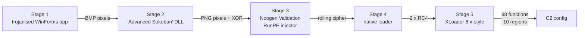

# Unwrapping XLoader statically: from a Sokoban-themed .NET crypter to the real C2, without running a single byte

I took one XLoader sample from MalwareBazaar and unpacked it to the end using static analysis only.
No sandbox, no debugger, no emulator. The sample never ran. The result is the full C2 configuration,
including the real C2 server, which neither Triage nor CAPE managed to extract.

- Sample: `0404070ceb269b1590a7d600bf02f47ed8559d02ef247d54f491ccd529828f26` (first seen 2026-10-12)
- Delivered as: `FLF7997_NEW_SHIPMENT_DETAIL.bat`
- Full technical report: [report.md](reports/formbook/2026-10-13-0404070ceb26/report.md)

## Results

| | |
|---|---|
| Real C2 | `hxxp://www[.]minha[.]cc/36vc/` (defanged) |
| Decoys | 63 domains, each with its own 4-character path ([stage5-c2.json](reports/formbook/2026-10-13-0404070ceb26/evidence/stage5-c2.json)) |
| Decrypted | 175 strings, 88 encrypted functions, 10 encrypted code regions |
| Reproduced | From scratch with separate tools: same payload hash, same C2 list, 0 differences |

The real C2 is encrypted separately from the decoys and swapped into one of 16 C2 slots at run time.
Several decoys are legitimate sites, which is normal for XLoader. I did not resolve, visit or look up
any of these domains.

## The chain

1. **Stage 1.** A trojanised Vietnamese restaurant app (.NET). It reads a DLL from the R, G, B values of a
   102×102 bitmap and loads it with `CallByName(AppDomain, "Load")`.
2. **Stage 2.** The "Advanced Sokoban" loader. It sleeps 24 seconds, crops a PNG to
   (width − 177) × (height − 225), reads the ARGB pixels and XORs them with the key `zre`.
3. **Stage 3.** A fake library called `Noogen.Validation`. It is an obfuscated RunPE injector. I recovered
   its resource key `hSLKhTt` with a known-plaintext attack on the DOS stub.
4. **Stage 4.** A native loader with no import table. Every action goes through an opcode dispatcher.
   I mapped all 22 commands ([stage4-selector-map.json](reports/formbook/2026-10-13-0404070ceb26/evidence/stage4-selector-map.json)),
   then decrypted the payload: RC4 over the whole body, then RC4 again per `0x32aa` block
   ([fb_stage4_unpack.py](tools/fb_stage4_unpack.py)).
5. **Stage 5.** The XLoader 8.x-style payload. Position-independent code, with almost everything
   encrypted until use.

## How stage 5 hides itself

XLoader encrypts its functions between two 6-byte markers ("eggs") and decrypts each one only while it
runs. The key comes from two 32-bit values: one in the wrapper and one passed in by the caller.

- For 28 functions, the caller's value was a constant in the code. Searching all 32-bit immediates found
  them ([fb_funcs.py](tools/fb_funcs.py)).
- For 8 more, the value only exists at run time. I wrote a C brute-forcer that tests all 2³² keys at once
  against every locked function, with a known answer mixed in as a control. It took about 40 minutes on a
  2-core laptop ([fb_eggbf.c](tools/c/fb_eggbf.c)).
- Decrypted functions contained more encrypted functions. I repeated the process through seven levels
  until none was left: 88 in total.
- The last three C2-loop functions never decrypt in the file. They are opened only inside the copy the
  malware injects into another process, using marker-bounded regions with two RC4 passes each. The keys
  for the second pass sat in code that the injected copy runs first.

Every key was checked before I accepted it ([fb_eggverify.py](tools/fb_eggverify.py)):

- both eggs occur exactly once in the image;
- every call in the decrypted code lands on a real function;
- the result still matches when all keys are applied in one clean pass.

*Entropy per 1 KB block of stage 5. Red: as recovered from stage 4. Black: after decryption.*

## Getting the C2

1. Each of the 64 entries is a Base64 string built by its own small function.
2. Decode it, then decrypt it with the custom RC4 ([fb_cipher.py](tools/fb_cipher.py)) and a key XORed with
   the entry number.
3. Decode again and decrypt with a shared key. Its seed, `0x99db1354`, is written as a constant in the code.
4. The real C2 is stored on its own, as `n8F/qFx/aS095PY6`, behind two different keys. The code puts it
   into slot 11 and keeps that slot's path.

C2 extractor: [fb_c2_extract.py](tools/fb_c2_extract.py).

## Checking my own work

I patched the payload in about 20 steps while working, and any one of them could have introduced an error.
So I rebuilt everything from the original file in one clean run ([fb_rebuild.py](tools/fb_rebuild.py)).
The rebuild applies the layers in whatever order they become available, accepts nothing that fails the
checks, and gives a byte-identical result. A separate extractor then reads every key from the rebuilt code
itself and gets the same C2 list.

One command runs the whole chain: [reproduce_c2.sh](tools/reproduce_c2.sh)
([results](reports/formbook/2026-10-13-0404070ceb26/evidence/stage5-c2-reproduction.json)).
The clean run also found two bugs in my new tools, which I fixed. Neither one changed the result.

## What is new and what is not

Already published: Threatray documented this .NET crypter family (2022 to 2025) and Unit 42 the bitmap
technique. Zscaler and Check Point documented XLoader's internals, including the egg functions, the
"Windows Explorer" User-Agent and the decoy C2 list. Check Point used a live debugger for part of their work.

New in this analysis:

- The crypter is still active in October 2026. The same "Advanced Sokoban" stage-2 DLL, byte for byte,
  fronts Formbook, PureLogs and XWorm samples.
- The carrier image has a fixed shape: width − 177 = height − 225. 37 of 51 samples have it, across
  13 families ([sokoban_geometry.json](reports/formbook/2026-10-13-0404070ceb26/crosssample/sokoban_geometry.json)).
- A full command map of the stage-4 loader.
- A fully static, reproducible extraction of the XLoader C2 configuration.

## Detections

| Rule | Type | Status |
|---|---|---|
| [msil_stego_loader_callbyname_getpixel.yar](detections/yara/msil_stego_loader_callbyname_getpixel.yar) | YARA: carrier geometry, host variants, builder artefacts | Geometry rule: 37/37 carriers, 0 hits on 245 local benign files ([results](reports/formbook/2026-10-13-0404070ceb26/crosssample/yara_validation_final.json)) |
| [msil_stego_loader_execution.kql](detections/kql/msil_stego_loader_execution.kql) | Microsoft Defender XDR hunt | Draft, not tested on telemetry |
| [formbook_2026-10_iocs.kql](detections/kql/formbook_2026-10_iocs.kql) | Defender XDR IOC query | Draft |
| [msil_stego_loader_execution.eql](detections/elastic/msil_stego_loader_execution.eql) | Elastic EQL hunt | Draft, not tested on telemetry |
| [formbook_2026-10_iocs.esql](detections/elastic/formbook_2026-10_iocs.esql) | Elastic ES\|QL IOC query | Draft |

Hunting ideas from stage 5:

- the WinINet User-Agent `Windows Explorer`;
- PowerShell started with `Set-ExecutionPolicy RemoteSigned -Scope CurrentUser`, then `-noexit "& ""…ps1"""`.

## All the code

| File | What it does |
|---|---|
| [fb_cipher.py](tools/fb_cipher.py) | Stage-5 cipher (difference passes plus custom RC4) |
| [fb_strings.py](tools/fb_strings.py) | Decrypts the 175 inline strings |
| [fb_funcs.py](tools/fb_funcs.py) | Decrypts egg functions whose key half is a constant |
| [fb_eggbf.c](tools/c/fb_eggbf.c) | 2³² key brute-forcer for run-time keys |
| [fb_eggverify.py](tools/fb_eggverify.py) | Validates and applies a recovered key |
| [fb_stage4_unpack.py](tools/fb_stage4_unpack.py) | Stage 4 to stage 5 |
| [fb_rebuild.py](tools/fb_rebuild.py) | Clean rebuild of the fully decrypted payload |
| [fb_c2_extract.py](tools/fb_c2_extract.py) | C2 extraction from the rebuilt payload |
| [reproduce_c2.sh](tools/reproduce_c2.sh) | The whole chain in one command |
| [stego_scan.py](tools/stego_scan.py) | Pulls PE files out of bitmap pixels (used across 51 samples) |
| [dotnet_resources.py](tools/dotnet_resources.py) | Reads .NET embedded resources |
| [ExportDecomp.java](tools/ghidra_scripts/ExportDecomp.java) | Ghidra headless export |
| [fb_entropy_svg.py](tools/fb_entropy_svg.py) | Draws the entropy figure |
| [md2html_report.py](tools/md2html_report.py) | Renders the report to HTML |
| [fetch-sample.py](tools/fetch-sample.py), [unzip-sample.py](tools/unzip-sample.py) | Download and unpack MalwareBazaar samples into quarantine |
| [install.sh](tools/install.sh) | Pinned, checksum-verified toolchain (Ghidra, capa, FLOSS, YARA-X, ILSpy) |

This repo has no samples, no binaries and no decompiled malware code. Hashes only.

## Open points

- Is `minha[.]cc` live, and do other builds share it? That needs passive DNS, which I have not done.
- One of the 64 entries is a 20-byte value, not a domain. I have not worked out what it is for.
- The YARA rules still need a large clean .NET test set, and the KQL and Elastic hunts need real telemetry.

Feedback and corrections are welcome.
