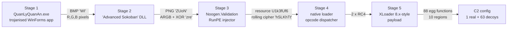
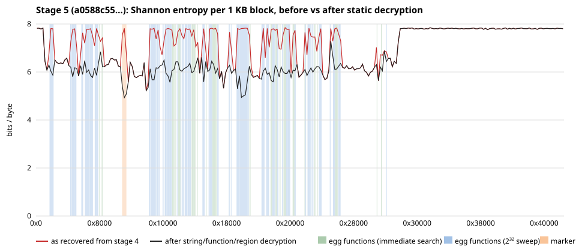

# Unwrapping XLoader statically: from a Sokoban-themed .NET crypter to the real C2, without running a single byte

| | |
|---|---|
| **Subtitle** | Five-stage loader chain, sample `0404070c…8f26` (first seen 2026-10-12), unpacked and decrypted end to end with static analysis only |
| **SHA-256** | `0404070ceb269b1590a7d600bf02f47ed8559d02ef247d54f491ccd529828f26` |
| **Family** | Final payload (stage 5) recovered statically and validated as code. Sandboxes label it Formbook (Triage score 10 `family:formbook`; CAPE `Formbook`, Malpedia mapping `win.xloader`). Static internals match published **XLoader 8.x** (Formbook's successor) descriptions point by point — egg-wrapped functions, the "Windows Explorer" WinINet User-Agent, command handlers, a 64-entry encrypted C2 list (see *Stage 5*); no public signature matches and the exact version is not determined. Stages 1–4 are loaders. |
| **First seen** | 2026-10-12 03:49 UTC (MalwareBazaar, reporter `threatcat_ch`, origin CH) |
| **Delivery** | Reported as email attachment `FLF7997_NEW_SHIPMENT_DETAIL.bat` (a PE with a `.bat` name — execution path unresolved, see *Delivery*) |
| **File** | PE32 .NET Framework 4.7.2 GUI, 869,376 bytes (imphash `f34d5f2d…` is the generic .NET `mscoree!_CorExeMain` imphash — not an indicator) |
| **Analysis** | Static only — rea 6.4.0 (+ Ghidra 12.1.4), ILSpy 11.1 (ilspycmd), capa 9.4.0, FLOSS 3.1.1, YARA-X 1.21.0. **No stage was executed.** Stages 2–4 were recovered offline by reimplementing each decoder in Python. |
| **Date** | 2026-10-13 (stages 1–4), updated 2026-10-14 (stage 5 internals, sweep, literature check) |

## Key findings

1. **Real C2 recovered without execution:** `hxxp://www[.]minha[.]cc/36vc/`,
   encrypted separately from 63 decoy domains and substituted into one of the
   16 C2 slots at run time. Triage and CAPE both crashed before networking and
   produced no configuration (§5.8, §5.7).
2. **Payload fully decrypted:** all 175 strings, all **88** egg-wrapped
   functions (nested up to seven levels deep) and all **10** marker-bounded code
   regions of the XLoader 8.x-style payload, every layer validated (§5).
3. **Independently reproduced:** one command rebuilds the decrypted payload
   from stage 4 (byte-identical, SHA-256 `0cdbe29c…6da2`) and re-extracts the
   C2 configuration with separate tools: zero differences (§5.9).
4. **The crypter is still active:** the "Advanced Sokoban" stage-2 loader —
   part of the .NET multi-stage delivery system Threatray tracked in 2022–2025 —
   fronts at least six families in two weeks of October 2026, including
   byte-identical DLLs in front of Formbook, PureLogs and XWorm (*Related samples*).
5. **Detections:** a cross-family YARA rule on the carrier-image geometry
   (width − 177 = height − 225) catches 37/37 carriers with 0 hits on 245 local
   benign files; host-variant and builder-artefact rules; KQL/EQL hunts
   (not yet validated on telemetry).

No stage was executed at any point — not in a sandbox, debugger or emulator.
What is already published (the crypter family, XLoader internals) is cited in
*Prior art and what is new here*.

## The chain at a glance



| Stage | SHA-256 | What it is | How it is recovered | MalwareBazaar |
|---|---|---|---|---|
| 1 | `0404070c…8f26` | Trojanised Vietnamese restaurant app (`QuanLyQuanAn`) | delivered file | known |
| 2 | `031f5387…f5c3` | 30,720-byte .NET DLL | R,G,B of a 102×102 BMP (`WI`) | **not found** |
| 3 | `9c9aa2ec…9494` | 536,577-byte .NET DLL, fake "Noogen.Validation", obfuscated RunPE injector | ARGB of a 544×592 PNG (`ZUoN`) + XOR key `zre` | **not found** |
| 4 | `d71939e6…3a6b` | 284,160-byte native PE32 packer/loader, no import table, entropy 7.97 | byte-array resource `U1k3fUf6`, rolling cipher, key `hSLKhTt` (recovered by known-plaintext) | **not found** |
| 5 | `a0588c55…abbb` | 272,384-byte position-independent x86 payload: XLoader 8.x-style (Formbook successor) | stage-4 body @0x2c51: RC4 key A over all, then RC4 key B per 0x32aa block | **not found** |

Stage 4 is a native loader (opcode dispatcher, API resolution by export-name
compare), not the stealer itself. Stage 5's own protection was removed in
layers, all statically and all validated:

| Stage-5 layer | Result |
|---|---|
| Inline encrypted strings | **175/175** decrypted (credential-theft targets, HTTP C2 format, PowerShell launcher, 12 injection hosts, 64 encrypted C2 entries) |
| Egg-wrapped functions, constant mask | **28** decrypted (key half found among code immediates) |
| Egg-wrapped functions, runtime mask | **8** more by a full 2³² mask sweep with a positive control |
| Nested egg functions (revealed inside decrypted code, 7 rounds) | **52** more; **88 in total, none left** |
| Marker-bounded regions | **10** decrypted (1 + 2 in the main path, 7 that only open inside the injected copy) |
| **C2 configuration** | **decoded: real C2 `www[.]minha[.]cc/36vc/` plus 63 decoy domains, each with its own 4-character path** (§5.8) |

## Delivery — how does a `.bat`-named PE execute? (unresolved)

**What is known.** MalwareBazaar records `delivery_method: email_attachment`
(reporter-declared), no email or archive (`intelligence.mail: null`), and every
sandbox ran the bare executable (ANY.RUN stored it as `exe`). The same lure
theme appears in two sibling builds on 2026-10-12, both hitting the same
community pixel-loader rules as this sample:

| SHA-256 | First seen (UTC) | Reporter | Submitted name | Size |
|---|---|---|---|---|
| `d9e039206aab…` | 03:07:26 | threatcat_ch | `MV Toroneos Vessel information.bat` | 875,008 |
| `0404070ceb26…` | 03:49:25 | threatcat_ch | `FLF7997_NEW_SHIPMENT_DETAIL.bat` | 869,376 |
| `78bd7e0c9feb…` | 06:18:06 | lowmal3 | `MV Toroneos Vessel particulars.com` | 876,032 |

Across 2,073 PE submissions for Formbook, AgentTesla, Remcos, Snake and
VIPKeylogger (2025-07 → 2026-10), 39 carry a `.bat` name, 25 `.com`, 9 `.scr`,
5 `.pif`; `threatcat_ch` usually submits `.exe` (151) and only occasionally
`.bat` (10). The `.bat` naming is therefore not a single reporter's convention.

**Why it matters.** Explorer double-click (`ShellExecute`) chooses the handler
by extension, so a `.bat` goes to `cmd.exe` as a script and a PE would not run.
`CreateProcess` inspects the file content (`MZ`) instead, so a `.bat`-named PE
started by a script, an archive tool or another launcher that calls
`CreateProcess` directly would execute. A `.com`-named PE (the sibling's name)
does execute on double-click.

**Status.** The delivery container is not public, so the execution path is not
established. Candidate explanations: the attachment was an archive or disk
image whose member had another name; a separate script launched it via
`CreateProcess`; or the `.bat` name was introduced by gateway/extraction
tooling. **Planned test:** in an isolated Windows VM, rename a *benign* PE to
`.bat` and record what Explorer, Outlook attachment preview and common archive
tools (7-Zip, WinRAR, Windows built-in ZIP) do with it — no malware required.

## Stage 1 — trojanised WinForms host (observed)

| Step | What happens | Evidence |
|---|---|---|
| 1 | `Program.Main` → `Application.Run(new FormDangNhap())`; payload code runs inside `FormDangNhap.InitializeComponent`, before user interaction | `evidence/ilspy-FormDangNhap.cs`; rea `ev_8ba095c6…` |
| 2 | `ComponentResourceManager(typeof(FormDangNhap)).GetObject("WI")` → `Bitmap` (32-bpp BMP, 102×102) | ILSpy; `tools/dotnet_resources.py` |
| 3 | `IndexerMapExtractor[image, 30720]`: flat index *i* → pixel *i*÷3, **column-major** (x = p ÷ H, y = p mod H), channel **R, G, B**. Capacity 102×102×3 = 31,212 bytes; first 30,720 used | ILSpy `get_Item`, `DecodeChannelAt` |
| 4 | `Interaction.CallByName(AppDomain.CurrentDomain, "Load", CallType.Get, bytes)` → `Assembly` | ILSpy; `#US` string `Load` (YARA `$us_load` @0xcff1) |
| 5 | `Activator.CreateInstance(assembly.GetTypes()[1], "5A556F4E", "7A7265", "QuanLyQuanAn")`; arguments from `Regex.Split(Pilow, "53 69 73 20 50 72 6F 70 70")` | ILSpy field `Pilow` |
| 6 | `ComputeCelestialMechanicsMetrics()` — ~50 lines of orbital mechanics; its result only gates `list.TrimExcess()` when equal to `long.MinValue` | ILSpy. The decoded bytes do not depend on it; we reproduced the payload without computing it. |

## Stage 2 — loader decoded from bitmap `WI`

`031f5387e15cb20e2b022482531e9b863da1c0825c3e057a5197cf1fc75ff5c3` · PE32 .NET DLL · names are Unicode noncharacters (U+FDD0…), flattened control flow, `AssemblyConfiguration("Deluxe")`.

| Step | What happens | Evidence (`evidence/ilspy-stage2.readable.cs`) |
|---|---|---|
| 1 | Constructor of a decoy `Form` subclass calls the loader with the three arguments | ~line 210 |
| 2 | `Thread.Sleep(24005)` | line 272 — a 24 s delay is observed; its purpose (e.g. outlasting sandboxes) is inferred |
| 3 | Hex-decodes arguments → resource name `ZUoN`, key `zre` | lines 235–239, 420–458 |
| 4 | `new ResourceManager("QuanLyQuanAn" + <encrypted suffix>, Assembly.GetEntryAssembly()).GetObject("ZUoN")` → PNG 544×592 RGBA | line 464 |
| 5 | Copies the top-left **(W−177)×(H−225) = 367×367** region, then reads it column-major as `BitConverter.GetBytes(Color.ToArgb())` (B,G,R,A per pixel): 367×367×4 = **538,756 bytes**; the first int32 is the payload length (**536,577**), leaving 2,175 bytes of padding | lines 299–305, 473–559, 561+ |
| 6 | XOR: `out[i] = in[i] ^ (in[last] ^ 0x70) ^ BigEndianUnicode("zre")[i mod 3]` — index wraps at the **string** length, so only key bytes `00 7A 00` are used | lines 361–418 |
| 7 | `LateBinding.LateGet(Thread.GetDomain(), …, "Load", bytes)` → `GetTypes()[7].GetMethods()[17].Invoke(null, null)` → `Environment.Exit(0)` | lines 320–359 |

**Which method is `[7]` / `[17]`.** `GetMethods()` ordering is not guaranteed on
.NET Framework, so we resolved it against metadata rather than trusting the
index. In TypeDef order (excluding `<Module>`) type 7 is
`V1wkf037Gv7RrOvRc6U.KqjZg13lpZOTOTFTIe6` (`0x02000009`). Its public declared
methods in MethodDef order put index 17 at **`FRC30iK47k()`, token
`0x060000b1`, `public static void`, no parameters** — the only signature
compatible with `Invoke(null, null)` apart from `GIP3h7dR1O()` (returns `bool`,
an is-administrator check). `FRC30iK47k` is the injector's main routine
(rea `ev_a14bf0b8…`). This matches the ordering the malware relies on in its
target runtime; it is not guaranteed to be portable.

## Stage 3 — obfuscated RunPE injector decoded from PNG `ZUoN`

`9c9aa2ec1bdf3c2357bd27641cf731725e20dca98ac83aa7903f114d07f09494` · PE32 .NET DLL · assembly `Noogen.Validation` 12.7.5.0, "Copyright © Noogen Systems 2026", GUID `F9D8C7A6-4E5B-3A2D-9F1C-8B7A6E5D4F3C` (rea `ev_043e8ae1…`).

**Protection:** every call goes through delegate proxies bound at run time
from an encrypted resource (`9dxmgQsq13hxFTZMTk.dTb0t0xerNiqqvbuI8`, custom
keystream); strings are decrypted from `CJIQDOlQffxFHJcp9H.ViBNaw7kpH3luqBxoU`
via `F6cLl9xwKFMQVo1L8x6(int ^ constant)`; opaque predicates reference fields of
`<Module>{b1bfda82-…}`. De4dot-style dynamic decryption was deliberately not
used because it executes the sample's own code.

| Step in `FRC30iK47k` | What happens | Basis |
|---|---|---|
| 1 | 5,000 ms delay via a `void(double)` proxy; later a delay of `config[35] × 1000` | ILSpy lines 2958, ~3090. Delay observed; purpose inferred |
| 2 | Writes a `DWORD 1` under an encrypted `HKLM` key/value name | ILSpy line 3008–3011; key name not yet decrypted |
| 3 | `VB5fcgbNcC = decrypt(readResource(name), key)` | line 3127. The two proxies have exactly the signatures of `lno35oZgXg(string) → byte[]` (ResourceManager read) and `PnK3ZS2bNP(byte[], string) → byte[]`; proxy binding is encrypted, so the link is established by signature plus the successful decryption below |
| 4a | Managed payload: `Assembly.Load(VB5fcgbNcC)` → entry point `Invoke` (`q993omctPa`) | lines 3148–3187 |
| 4b | Native payload: `QOq34PWWnn` → `(hostPath, VB5fcgbNcC)` where `hostPath = PvR3IDLAdk(…)` built via `typeof(RuntimeEnvironment)` | lines 3188–3195. **Inferred:** host is a binary in the .NET Framework runtime directory |
| 5 | RunPE implementation `Kqk3xkWvSN(string, byte[])` (token `0x060000a9`): `STARTUPINFO`, `PROCESS_INFORMATION`, `bytesWritten`; APIs resolved with `LoadLibraryA`/`GetProcAddress` + `Marshal.GetDelegateForFunctionPointer` from split strings (`"Virtual ".Trim() + "Alloc"`, `"Write "+"Process "+"Memory"`, `VirtualProtect`, `OpenProcess`, `FindResourceA`) | ILSpy lines ~9100–9160 |

**Payload cipher (`PnK3ZS2bNP`).** With `K = Encoding.<?>.GetBytes(key)` and
*n* = data length, for `j = 0 … n`: `i = j mod n`,
`P[i] = ((P[i] ^ K[j mod |K|]) − P[(i+1) mod n] + 256) mod 256`; then the last
byte is dropped. Because each step only mixes `c[i]`, `c[i+1]` and one key
byte, `K[i mod |K|] = c[i] ^ ((p[i] + c[i+1]) mod 256)`. Using the standard
DOS stub as known plaintext gave a keystream with period 7 → key
**`hSLKhTt`** (single-byte encoding). Decrypting the 284,161-byte `U1k3fUf6`
array with the exact algorithm yields a valid PE (`MZ`, `PE\0\0`, i386).

`U1k3fUf6.resources` contains exactly one entry: `U1k3fUf6`, type `byte[]`.

## Stage 4 — native loader: command map and payload decryption (static)

`d71939e6e91ad412304d04b1a2385afa105c9921086e0381b54054f8dfe33a6b` · PE32 i386 GUI · ImageBase `0x400000`, one `.text` section (VA `0x1000`, raw `0x1000`, size `0x44600`) · **no import table** · entry `0x4026e0` · timestamp `0x5D019EB5` (2019-06-13; probably not the real build date). Analysed with Ghidra 12.1.4 via rea (entry `ev_6a4402e9…`, dispatcher `ev_10f13139…`, `FUN_00401000` `ev_30f4adf6…`) and objdump (`evidence/stage4-code.objdump`). Nothing was executed.

### How the dispatcher selects a handler

- `entry` keeps all state in one stack block. The dispatcher `FUN_004010a0` finds it by scanning the stack for the marker `0x109ddd80` (planted at `0x40276e`, `mov [ebp-0x182],0x109ddd80`) and sets `ctx = marker − 0x346`. Hence `ctx[off]` is entry's `local_(0x4cc−off)` in Ghidra naming; verified on five fields (command `ctx[0x185]` = `local_347`, seed `ctx[0x362]` = `local_16a`, selector pointer `ctx[0x155]` = `local_377 = &local_176`, selector `ctx[0x356]`, marker `ctx[0x346]` = `local_186`).
- Command byte *c* = `ctx[0x185]`. The dispatcher copies the seed `0xbb670959` (planted at `0x40275e`) into `ctx[0x356]` and XORs each of its bytes with *c*: **selector = `0xbb670959 ^ (c × 0x01010101)`**.
- Each handler runs when `(selector ^ C) == ctx[F]`. The 22 field values are planted by command `0x14` (one by entry itself: `ctx[0x18d] = 0xa0221871` at `0x402778`). Solving gives one command byte per handler; **all 22 solutions are a single byte repeated four times**, which validates the model. Full data: `evidence/stage4-selector-map.json`.

| Cmd | Handler (XOR const @ address) | Role (decompiled `FUN_004010a0` line) | Arguments / ctx fields used |
|---|---|---|---|
| `0x14` | `0x0f51053c` @ `0x402506` | Initialise all selector fields (L617) | writes 21 `ctx[F]` constants (+ decoy `ctx[0x3a2]`) |
| `0x73` | `0x85d342c0` @ `0x401170` | Scan start = `0x40118f` (get-PC: `call 0x40118f` @ `0x40118a`) (L173) | `ctx[0x3c3]` |
| `0xb6` | `0x22c127ec` @ `0x4011ad` | Region length `0x44451` (`mov [ecx+0x1a5],0x44451` @ `0x4011c1`) (L177) | `ctx[0x1a5]` |
| `0xb5` | `0x79062a70` @ `0x4011d4` | Find first run of `ctx[0x151]` = 11 zero bytes after scan start; base = run − `0x44451` (L180) | `ctx[0x3c3]`, `ctx[0x151]`, `ctx[0x1a5]` → `ctx[0x3d8]`, `ctx[0x3ae]` |
| `0x1b` | `0x13bfb998` @ `0x4012b4` | Body pointer = base + `0x1c51` (`0x4012c4`) (L198) | `ctx[0x3d8]` → `ctx[0x38e]` (entry copies to `ctx[0x161]`) |
| `0x1e` | `0xde71d270` @ `0x401301` | PE export walk (sets up `+0x78` export dir), recurses with `0x0b` (L203) | `ctx[0x480]`, `ctx[0x3cb]` |
| `0x0b` | `0xa3e3ab77` @ `0x401872` | Export-name loop, compares names via `0x1f` (L366) | `ctx[0x478]`, `ctx[0x31a]` |
| `0x1f` | `0x44245700` @ `0x401de3` | Case-insensitive name compare (L491) | `ctx[0x3aa]`, `ctx[0x3dd]`, `ctx[0x34e]` |
| `0x90` | `0xdd871880` @ `0x4013b0` | Copy constant table selected by `ctx[0x306]`: `0x188` (key, `0x4013fb`), `0x4a35` (`0x4014cd`), `0x4a4e` (`0x401564`) (L215) | `ctx[0x306]` → `*ctx[0x444]` |
| `0xe6` | `0x394e7648` @ `0x40162c` | XOR 5 dwords of `*ctx[0x444]` with `ctx[0x175]` (key derivation) (L321) | `ctx[0x444]`, `ctx[0x175]` |
| `0xe2` | `0x1731fbbc` @ `0x401690` | RC4 state setup; split constants `0x78`, `0x0e`, `0xdb` (L328) | state `ctx[0x35a]`, data `ctx[0x444]`, key `ctx[0x205]`, len `ctx[0x34e]` |
| `0xe5` | `0x0c23a3d4` @ `0x40170a` | KSA init: `+0x88→256`, `+6→keylen 20`, `−0xda→1`; `S[i]=i`, `T[i]=key[i%20]`; → `0x25` (L338) | state |
| `0x25` | `0x3b9316f6` @ `0x402222` | KSA mix `j=(j+S[i]+T[i])%256`, swap; → `0xf9` (L564) | state |
| `0xf9` | `0xff4083c0` @ `0x402361` | RC4 PRGA: `i++; j+=S[i]; swap; data ^= S[S[i]+S[j]]` (L585) | state |
| `0x85` | `0x5e86d210` @ `0x401a36` | Layer-2 loop: `0x9cff13ad ^ 0x9cff13b8 = 21` blocks of `0x32aa`; junk stub per block; RC4 per block with key from `local_d4 ^ 0xc71f88f5` (`0x401ca5`) (L400) | `ctx[0x161]`, `ctx[0x30e]`, `ctx[0x171]`, `ctx+0x2e2` |
| `0xa3` | `0x7223191c` @ `0x401db7` | Write 68-byte stub (`FUN_00401000`, XOR 7): decoded = junk loop to `0x5207`, `ret 0`, no data access (L488) | `ctx[0x31a]` |
| `0x46` | `0xf1a02fd0` @ `0x401d5d` | Jump to body + `0x2d9a0` (`add edx,0x2d9a0` @ `0x401d95`) (L480) | `ctx[0x161]` |
| `0x26` | `0xc0914458` @ `0x4020f5` | Resolve/prepare an API call (L554) | — |
| `0x71` | `0xdd9999c0` @ `0x401820` | Module lookup, recurses `0xa2` (L359) | `ctx[0x480]` |
| `0xa2` | `0xf76c09ec` @ `0x401fd0` | PEB/module-list walk (L529) | `ctx[0x44c]`, `ctx[0x454]` |
| `0x9d` | `0xd803e728` @ `0x40212d` | (L558) | — |
| `0x9e` | `0x26b2f704` (≠) @ `0x40217e` | Guard around `0x25`/`0xf9`/`0x14` branch (L563) | — |

Rows `0x26`, `0x71`, `0xa2`, `0x9d`, `0x9e` are mapped but their roles are only outlined; they are not on the payload path.

### Data flow of the body and keys (entry `0x4026e0`)

1. `0x14` → `0x73`, `0xb6`, `0xb5`: base located at **VA `0x401000`** (the first 11-zero run is at VA `0x445451`/file `0x45451`; `0x445451 − 0x44451 = 0x401000` = start of `.text`).
2. `0x90`(`0x4a35`) → 9 bytes to a data buffer; `0x90`(`0x188`) → 20-byte table to `local_43`.
3. `0xe6` with `ctx[0x175] = 0x7f6e7818` (`0x402839`) → **string key** = table `0x188` ^ `0x7f6e7818` = `9fc21254c2977ab20912a84df885331800a0ed9b`.
4. `0xe2/0xe5` (len 9), and later `0x90`(`0x4a4e`) + `0xe2/0xe5` (len `0x17`): the strings decrypt to **`ntdll.dll`** and **`NtAllocateVirtualMemory`** — independent validation of tables, XOR constant and RC4.
5. `0x1e`, `0x26`, indirect call (`NtAllocateVirtualMemory`, inferred from step 4), copy of `0x44451` bytes from base into the allocation; `0x1b` → **body = allocation + `0x1c51`**, i.e. file `0x2c51`–`0x45451` (`0x42800` bytes, ending exactly at the zero run).
6. `0xe6` with `ctx[0x175] = 0x4c591180` (`0x402a99`) → **payload key A** = string key ^ `0x4c591180` = `1fd34b18428623fe8903f10178946a5480b1b4d7`.
7. `0xe2/0xe5`, len `0x42800` (`0x402acd`) → **layer 1: one RC4 pass (key A) over the whole body**.
8. `0x85` → **layer 2: RC4 restarted per `0x32aa` block (exactly `0x9cff13ad ^ 0x9cff13b8` = 21 full blocks, ending at body offset `0x427f2`; the final 14 bytes keep layer 1 only — corrected 2026-10-14 during the clean reproduction) with key B** = `local_d4[0:20] ^ 0xc71f88f5` = `18c61bf4103605c6229f2881cb60fa0e595869f5`.
9. `0x46` → jump to **body + `0x2d9a0`**.

**Earlier failure explained.** The first attempt used key B only and 4-byte-aligned offsets; the body starts at the unaligned file offset `0x2c51` and has two RC4 layers.

## Stage 5 — XLoader 8.x-style payload, fully decrypted statically

`a0588c553619f40b3563ba701f0bde5e3330beb3552f16dd2baa136dd6acabbb` · 272,384 bytes · position-independent x86 blob (no `MZ`/`PE` header) · MalwareBazaar: not found.

**Validation.**

| Check | Result |
|---|---|
| Embedded-string decryption with the same key path | `ntdll.dll`, `NtAllocateVirtualMemory` |
| Body location | base resolves to `.text` start `0x401000`; body ends exactly at the zero run |
| Entry at `+0x2d9a0` | `push ebp; mov ebp,esp; sub esp,0x64; call 0x2bfd0; …; ret`, followed by `call $+5; pop eax; ret` get-PC thunks and jumps into the blob |
| Call-target coherence | **2,619 / 2,662 (98.4 %)** in-range `E8 rel32` calls land on `push ebp; mov ebp,esp`; encrypted body control: 0 / 0 |
| Entropy | 8.00 → 7.72 overall; first ~200 KB 7.25–7.69, last ~96 KB 7.98–7.99 (still-encrypted data) |

**Family.** Elastic's `Windows_Trojan_Formbook` rules and YARA Forge core
(incl. `MALPEDIA_Win_Formbook_Auto`) do not match stage 5; Elastic publishes no
XLoader rule. After the decryption work below, the internals match published
XLoader 8.x descriptions on every point we could check (table at the end of
this section). We therefore call it **XLoader 8.x-style**; the exact version is
not determined.



*Figure: Shannon entropy per 1 KB block of stage 5 (red: as recovered from
stage 4; black: after the string, function and region decryption below).
Shaded: decrypted egg functions (green: first round, key half found among
immediates; blue: 2³² sweep and all later nested rounds, 60 functions) and the
first marker region (orange). Mean block entropy 7.19 → 6.64 with all 88
functions and 10 regions decrypted; the ~85 KB tail at `0x2db2c` (copied by the
injection builder) stays at ~8.0.*

### 5.1 Method and validation rules

Everything in this section is static: decompilation (Ghidra 12.1.4 headless,
`tools/ghidra_scripts/ExportDecomp.java`), objdump, and Python/C ports of the
payload's own routines. **No byte of the sample was executed** — not in a
debugger, emulator or sandbox. A decryption is reported only if it passes all
applicable checks:

| Check | What it rules out |
|---|---|
| Output contains expected structure (readable strings, `55 8b ec` prologues, `8b e5 5d c3` epilogues) | random-looking false keys |
| **Egg uniqueness**: the decrypted start and end eggs each occur exactly once in the image, start egg within the wrapped function | coincidental 6-byte matches |
| **Call coherence**: every `E8` call in a decrypted body (counted from a real disassembly, not raw `E8` bytes) lands on a function prologue or a known get-PC thunk | wrong keys that still match eggs |
| **Positive control** for brute force: a wrapper with a known answer is mixed into the search and must be recovered | broken search code |
| Byte-identical result whether keys are applied one at a time or in a single pass | order-dependent patching errors |

### 5.2 Cipher (`FUN_00004440` and helpers) — `tools/fb_cipher.py`

All stage-5 layers use one routine, driven by a state block whose sizes are
hidden as split constants (`0x78 + 0x88 = 256`, `0x0e + 6 = 20` key bytes,
`0xdb − 0xda = 1`, sentinel `0x9f015014`). Order:

1. pass A — backwards difference: `d[n−1−i] −= d[n−i]` for i = 1…n−1
2. pass B — forwards difference: `d[i−1] −= d[i]`
3. RC4 with a 20-byte key
4. pass A, 5. pass B

Mode byte `0x8d` = subtract (decrypt); `0x80` = add. The port was validated
on every layer below.

### 5.3 Strings (`FUN_00008680`) — 175/175 decrypted

Each string is built inline (`mov [ebp−x], imm32` …), copied, and decrypted in
place. Key = `FUN_00001220` table `f5cc60ef712839b739ce6e04f5f6e72602f6b090`
XOR `0x90` per byte, then XOR the one-byte `BL` value loaded just before each
call (`mov bl, imm8`). `tools/fb_strings.py` parses every `call 0x8680` site.
Output: `evidence/stage5-strings.json`. Groups:

| Group | Examples (verbatim) |
|---|---|
| Injection / hollowing hosts (12) | `PATHPING.EXE`, `prevhost.exe`, `msinfo32.exe`, `TapiUnattend.exe`, `certreq.exe`, `mountvol.exe`, `help.exe`, `cipher.exe`, `cmstp.exe`, `notepad.exe`, `systeminfo.exe`, `AtBroker.exe` |
| Libraries | `ws2_32.dll`, `rstrtmgr.dll`, `sqlite3.dll`, `winsqlite3.dll`, `crypt32.dll`, `vaultcli.dll`, `nss3.dll`, `wininet.dll`, … |
| Browser credentials | `\Google\Chrome\User Data\Default\Login Data`, `SELECT origin_url, username_value, password_value FROM logins`, `\logins.json`, `formSubmitURL`, `usernameField`, `encryptedUsername`, `encryptedPassword`, `profiles.ini`, `\Opera Software\Opera Stable`, Edge/Chrome executable paths |
| Mail credentials | `Office\15.0\Outlook\Profiles\Outlook\`, `Windows Messaging Subsystem\Profiles\Outlook\`, `\Foxmail`, `\Accounts\Account.rec0`, `\Data\AccCfg\Accounts.tdat` |
| HTTP (raw socket) | `POST `, ` HTTP/1.1\r\n`, `Host: `, `Connection: close`, `Content-Length: `, `Cache-Control: `, `Origin: http://`, `Content-Type: application/x-www-form-urlencoded\r\n`, `Accept: `, `Referer: http://`, `Accept-Language: `, `Accept-Encoding: `, `User-Agent: ` |
| WinINet | `InternetOpenA`, `InternetConnectA`, `HttpOpenRequestA`, `HttpSendRequestA`, `InternetReadFile`, `InternetCloseHandle` |
| Form-grabbing keywords | `pass`, `token`, `email`, `login`, `signin`, `account`, `persistent`, methods `GET`/`PUT`/`POST`/`OPTIONS` |
| PowerShell | `Set-ExecutionPolicy RemoteSigned -Scope CurrentUser`, `-noexit "& ""`, `PowerShell.exe` |
| Other | `SeShutdownPrivilege`, `\BaseNamedObjects`, `\Registry\User`, `\Registry\Machine`, env vars `USERNAME`, `APPDATA`, `TEMP`, …, `Kahoot!` |
| **Encrypted C2 list (64)** | see 5.7 |

### 5.4 Egg-wrapped functions (`FUN_00001670`)

**Mechanism.** A wrapper plants constants in a struct, calls
`FUN_000018f0`/`FUN_00001910` → `FUN_00001670`, calls the target, then
re-encrypts it (`FUN_00026600`). `FUN_00001670`:

- mask = `struct[0x34] ^ struct[0x60] ^ 0xdf20ff20`, where `+0x34` is planted by
  the wrapper (`local_80`) and `+0x60` comes from the wrapper's **caller**
  (`*(param_2 + 0x28)`);
- key = `FUN_00001150` base `35b98505 f21dfceb ae10be3a dd719b86 d5d4d340`
  (5 dwords) each XOR mask;
- decrypts the 6-byte start egg (`local_14`, `local_13`, `local_f`) and end egg
  (`local_70`, `local_6c`) with the cipher, scans the image for them, NOPs both
  (`90×6`) and decrypts the bytes between;
- the third argument (0 / 4) passed by `FUN_000018f0` / `FUN_00001910` is never
  read (checked in the disassembly).

The first decompilation exposed 40 wrappers; nested rounds later raised the total to 88. First two batches (`evidence/stage5-funcs.json`,
`evidence/stage5-funcs-bruteforce.jsonl`):

| Batch | How the mask half was found | Decrypted |
|---|---|---|
| 1 | `+0x60` is a literal in the caller → searched all 32-bit immediates in the image (`tools/fb_funcs.py`) | **28/40**; after patching, 444/448 call targets coherent |
| 2 | `+0x60` computed at run time → **full 2³² sweep** of the mask itself (`tools/c/fb_eggbf.c`), one RC4 KSA per mask shared by all wrappers, match on the start egg within 0x20 bytes of the target; then `tools/fb_eggverify.py` | **8/8** wrappers whose target prologue is visible (table below); control `FUN_000269b0` recovered with its known `c60 = 0x2bc0cdf0` at the known offset +10 |

| Wrapper → target | c60 | Body | Calls | Role (from decrypted code) |
|---|---|---|---|---|
| `FUN_00029300` → `0x4cf0` | `0x3547db40` | 1,106 B | 26/26 | Setup: resolves 7 APIs by hash (`0x7b53ce8c`, `0x1a04b2ac`, `0xa2b554f0`, `0x64a81337`, `0xf721fca5`, `0x141ea815`, `0x8178d93b`) and chains indirect calls |
| `FUN_000267a0` → `0x26120` | `0x7424d1c0` | 1,207 B | 31/31 | **Injection builder**: allocates a 0x398a-byte settings block from context fields; copies 0x14be8 bytes of its own code into an RW and an RWX allocation (`0x3000`, prot `4`/`0x40`); places the settings at +0x199e0; transforms both copies with the cipher using the key at `ctx+0x190`; fills placeholders `0x11111111`–`0x1111111f`, `0x111111aa/bb/cc`, `0x77777777`; writes `90 90 90 c3` and `90 90 90 cb` (**`retf`** — consistent with a 32→64-bit "Heaven's Gate" transition, inferred) |
| `FUN_000275a0` → `0x24fe0` | `0x76e07ae8` | 441 B | 12/12 | **WinINet HTTP downloader**: User-Agent **`Windows Explorer`**, port 80, service 3 (HTTP), `GET` + path, read loop into a buffer capped at `0x274000` (~2.5 MB), optional 20-byte header from `+0x14a38`; sets completion flags `+0x180bf88` and `+0x2380` (the flag the main C2 loop tests) |
| `FUN_000278a0` → `0x106f0` | `0x44f99684` | 743 B | 18/18 | **Run-DLL command**: builds `"%windir%\System32\|SysWOW64\rundll32.exe" "<dll>",<entry>` (UTF-16 stack strings) |
| `FUN_000279a0` → `0x10ce0` | `0xdd1433b8` | 930 B | 37/37 | **Delete-cookies command**: `\Cookies`, `\INetCookies`, `\Low`, `.sqlite`, `\Current Session`, `\Microsoft\Windows` |
| `FUN_00027e80` → `0xff20` | `0x28e84590` | 484 B | 16/16 | **Run-PowerShell command**: `urlmon.dll` + API hash `0x84f82554` (download, inferred), `.ps1`, then `FUN_0000fdd0` runs `PowerShell.exe Set-ExecutionPolicy RemoteSigned -Scope CurrentUser` and `PowerShell.exe -noexit "& ""<file>.ps1"""` (API hash `0x7a37e095`) |
| `FUN_000283c0` → `0x1e090` | `0x8e14a074` | 320 B | 12/12 | Helper building UTF-16 `\r\n\r\n` and `null`; role not established |
| `FUN_000289f0` → `0x1cfe0` | `0x74f6a0ef` | 915 B | 40/40 | **Firefox credential parser**: stack strings `hostname`, `httpRealm`; calls the producers of `formSubmitURL`, `usernameField`, `encryptedUsername`, `encryptedPassword` (`0x9660`–`0x9780`) |

Earlier batch-1 functions of note: `0x25aa0` raw-socket HTTP client
(`GET <path> HTTP/1.1`, `Host`, `Connection: close`, User-Agent
`Mozilla/5.0 (Windows NT 10.0; WOW64; Trident/7.0; yie10; rv:11.0) like Gecko`
built by `FUN_00002510` from bytes XOR `0x67`); `0x8440` sleep-mask (XORs the
image with a 20-byte key around a call, then restores it); `0x16370` the region
decryptor below.

**Nested layers (all removed).** Decrypting a function exposes wrappers
inside it, so the process was repeated until no wrapper or encrypted function
remained: 28 → +8 (sweep) → +17 → +3 → +1 → +4 → +4 → +2 → +15 → +6 = **88
functions**, every one validated as in §5.1 (four bodies accepted after
documented manual review because their remaining call target is a frameless
leaf such as `mov ecx,[0x7ffe0018]`, or because they contain no calls at all:
the Base64 encoder and decoder). Records: `evidence/stage5-funcs*.json*`.
Many recovered mask halves equal a constant the caller plants just before the
call (`0x3bf2bd07`, `0xfe51e6fc`, `0x62d083e0`, `0xdfea676c`, `0x5521a610`,
`0x6b2ddfea`, `0x395c79e6`, `0x203eae88`), an independent confirmation.
The final decompilation (`evidence/stage5p-decomp.c`) has 758 functions and
none that fail to decompile.

### 5.5 Marker-bounded regions (10): first region `0xad83–0xb636`, then nine more

- Markers are computed after the buffer is zeroed (`FUN_0002c470`):
  start `0x16bd229c ^ 0x444af82c` = **`0x52f7dab0`** (at `0xad7f`), end
  `0x16bd229c ^ 0xdaf8b17c` = **`0xcc4593e0`** (at `0xb636`).
- Pass 1: cipher with the 20-byte key at `ctx+0x190` (`FUN_00001480` table
  `c1ce8020 bd0ae03a 280accfb 591a29a7 dec21541`, each byte XOR `0xbc` by
  `FUN_00001110`).
- Pass 2: cipher with `8beaa480 930d7770 3284ed4a 1117b223 d0cb7d68`, each dword
  XOR `0xcd08ad66`.
- Restore: `0x36e8 ^ 0xbdbd`, `0x51 ^ 0xbd` → `55 8b ec` at region−3;
  `0x9f015014 ^ 0x0f91c084` = `90909090` over the end marker.
- Validation: entropy 7.93 → 5.03; begins `81 ec b8 01 00 00 56 90×6 c7 85 50 ff ff ff …`.
- Content: `FUN_0000ad80` is mostly junk arithmetic loops (constants such as
  `0x4bab`, `0x51d3`, `0x9d` — not addresses), guarded by
  `cmp [ebp−0x24], 0x5ec4f8f0`, then its **only call: `FUN_0002c080`**, which
  zero-allocates the 0xc5c-byte main context, initialises it
  (`FUN_00004700` → `FUN_000143e0`/`FUN_00014360`) and continues in `FUN_00026e50`.

Note: the same `ctx+0x190` key protects this region and is the key the
injection builder (`0x26120`) applies to the copy of its own code.

**Further regions.** The same marker scheme (start/end dwords =
`0x16bd229c ^ constant`, pass 1 with `ctx+0x190`, pass 2 with a region key,
prologue restored) protects nine more blocks:

| Region | Function | Pass 1 run by | Pass 2 run by, key (5 dwords, XOR mask) |
|---|---|---|---|
| 2 (`9d300bd4`/`fdceb2ea`) | `0x12b90` | `0x131a0` | `0x131a0`: start-marker dword + 16 zero bytes |
| 3 (`9fb32974`/`33c0d4dc`) | `0x239d0` | `0x12b90` | `0x12b90`: `0a9d4de1 a8194425 4ceb9d77 2a57fbd6 41ba2449` ^ `ad1f5922` |
| A (`7d77da90`/`e333b780`) | `0x4730` | `0x239d0` (in the copy) | `0x13460`: `b3cd1c3b e4288676 16cca825 77fe9e0b abb8b071` |
| B (`fbbbed04`/`bb50131c`) | `0x6bd0` | `0x239d0` | `0x15e60`: `8cb5059d 4bebce4f 78f54d72 65fac627 77bfb4b0` ^ `833e96ca` |
| C (`ac47b29c`/`69a290ae`) | `0x6290` | `0x239d0` | `0x15e60`: `7c5f7eea d99d2cdc 87ee791c 0d18cd43 914f0768` ^ `f2516c46` |
| E (`c71e25bd`/`6f567180`) | `0x44d0` | `0x239d0` | `0x15e60`: `88c4d89f 70ef3fe5 059aa4f4 76e09247 e07ed3c3` ^ `82b25a12` |
| F (`4dc37f6e`/`c208538c`) | `0x5b30` | `0x239d0` | `0x15e60`: bytes `91a71a83 3c3c21f6 b136a7f3 1e18 [bl] a5420d34 07` ^ `74712e55` per dword; the one register byte `bl` = `0x47` is the only one of 256 values giving a prologue |
| G (`8dd4415c`/`202d3544`) | `0x15e60` | `0x239d0` | `0x13460`: `f85b8f83 c89ce6ac e4b279c2 f4f304f9 f0e3dfcd` ^ `b97052e0` |
| H (`82d4f908`/`2eb0e8c4`) | `0xe6b0` | `0x239d0` | `0x18460`: `8908e92c 848ee530 08f043e6 715ab021 24d1466e` ^ `b926c5d2` |

(Region D's markers `b8aaf2ec`/`e2eea598` are referenced but do not occur in
this build.) Regions A–H are only ever opened in the **copy** that
`0x239d0` builds for injection, and their second pass runs inside the
injected component (entry `0x2bca7` → `0x2c110` → `0x13460` → `0x15e60`) —
which is why the C2-loop functions never decrypt in the file as stored. After
both passes each block is again an egg-wrapped function; for `0x44d0` the
exposed start egg is exactly `551d3b2e64c6`, the value predicted from the C2
loop's planted `0x203eae88`.

### 5.6 Main loop and the network paths

`FUN_00005a30` waits (`Sleep`-like call with `0x1388` = 5,000 ms, API hash
`0x6c15dcc9`) and branches on a state word `ctx+2000`: `0x100` → if the flags
at `+0x2714`/`+0x24bc` are set and `+0x2380 == 0` it calls `FUN_000113c0`
(clipboard: opens clipboard, `GetClipboardData(13 = CF_UNICODETEXT)`), then
`0x44d0` (via `FUN_00028df0`), then `FUN_00004600` (builds and sends the
outgoing packet via `0x5b30`/`0x6290`, which select and decode C2 slots, §5.7); `0x200` →
`FUN_000059d0`. Two transports are present: the raw-socket client
(`0x25aa0`, IE11 User-Agent) and the WinINet downloader (`0x24fe0`,
`Windows Explorer`).

### 5.7 C2 decoder (`FUN_00001b20`)

`FUN_00001b20(ctx, out, n, mode)`, n = 1…64:

- **mode ≠ `0xde` (domain):** call producer *n* (`0x2610` + …, a 64-way
  `if` chain; this is the only reference to the producers) → Base64 string →
  Base64-decode (`0x150a0`, standard alphabet stored XOR `0x7d`) → cipher with
  key = `ctx+0x12a1` XOR *n*, where `ctx+0x12a1` = `FUN_000013b0`
  (`610f2362 6a06ba9b 1b53922a bee888e0 82d1c60f`) XOR `0xe7` → Base64-encode.
- **mode = `0xde` (path):** `"/" + cipher(table[n], key (9564799d b19a74d9
  6452b585 b8210c1e bd496a1b) XOR n) + "/"`, table = 68 dwords on the stack.
- The callers (`0x5b30`, `0x6bd0`) Base64-decode the entry again, append it
  to a prefix and decrypt it with the shared key at `ctx+0x1a90` = seed XOR
  (`76b28727 1667f36a 5c4e0b9b d83c3c7b 3f757df5`), seed written as the
  constant `0x99db1354` (`*(shared + 0x2620)`); then SHA-1 of the URL is stored
  per slot (Zscaler's "C2 URL key").
- **Real C2:** string `n8F/qFx/aS095PY6` (`FUN_00008710`) → Base64 → cipher
  with `FUN_00001350` (`f58b0f37 774e60b1 b5331a7e 1ad28408 e9055a7c`) ^ `0x75`,
  dwords ^ `0xe494aef0`, bytes ^ `0x98` (`0x4730`) → cipher with
  `FUN_000012f0` (`5fecae1f 9ed331af 631c9302 19a105b3 476ad0bc`) ^ `0x44`
  (`0x6bd0`) → **`www.minha.cc`**. Its first four bytes (`www.`) are the prefix
  for every decoy. `0x6bd0` fills 16 slots from the fixed entry order
  `4 49 63 1 34 61 64 50 9 26 8 12 19 30 59 60` and replaces the domain of the
  slot indexed by `ctx+0x1290` (= 11, entry 12) with `www.minha.cc`, keeping
  that entry's path `/36vc/`. `0x5b30` instead picks six random entries.

### 5.8 Decoded C2 configuration

Validation: all 63 Base64 entries decode to syntactically valid domains with
real TLDs, all 64 paths to exactly four lowercase alphanumerics, and the real
C2 to 12 clean ASCII bytes through two independent key chains. **No domain was
resolved, contacted or looked up.** Full data: `evidence/stage5-c2.json`.

**Real C2 (separately encrypted, substituted into slot 11):**
`hxxp://www[.]minha[.]cc/36vc/`

**Decoys** (64 entries; URLs are `www.<domain>/<path>/`; entry 21 is the
20-byte non-Base64 value and yields no domain). Several are clearly unrelated
legitimate sites, as expected for XLoader decoys; listing a domain here is not
an accusation against its owner.

| # | Domain | Path |
|---|---|---|
| 1 | `smardadosenatu[.]cloud` | `/mkdy/` |
| 2 | `banoffice[.]team` | `/1xx6/` |
| 3 | `nowvideo[.]li` | `/4hfb/` |
| 4 | `amp-mariatogel[.]com` | `/876i/` |
| 5 | `movilidad[.]com[.]co` | `/wb9v/` |
| 6 | `supersloteasy[.]com` | `/1ub8/` |
| 7 | `lhw18924a1[.]cfd` | `/fl4z/` |
| 8 | `eolienzaer[.]com` | `/v5tr/` |
| 9 | `jts6831897[.]casa` | `/kc5s/` |
| 10 | `tv-51cao[.]cc` | `/e1vw/` |
| 11 | `kereszturicatering[.]hu` | `/w9jk/` |
| 12 | `templatemonster[.]com` | `/36vc/` |
| 13 | `unggul68[.]com` | `/9i8u/` |
| 14 | `erikovo[.]ru` | `/lbpf/` |
| 15 | `getcodeaudit[.]co[.]uk` | `/vxqz/` |
| 16 | `adndigital[.]com[.]mx` | `/skmn/` |
| 17 | `leveluphealth[.]online` | `/bc57/` |
| 18 | `asklepiachat[.]com` | `/vuun/` |
| 19 | `torrentfunk[.]com` | `/rwos/` |
| 20 | `roamago[.]com` | `/tqap/` |
| 21 | `—` | `/v7fe/` |
| 22 | `danxenvi[.]site` | `/7whg/` |
| 23 | `mimao[.]net` | `/1try/` |
| 24 | `francisandduffy[.]com` | `/ml5l/` |
| 25 | `22374744[.]xyz` | `/74ou/` |
| 26 | `zyjcwg[.]com` | `/ylmm/` |
| 27 | `huahud[.]cc` | `/l83v/` |
| 28 | `parenting-attuned[.]com` | `/m7dw/` |
| 29 | `2863006[.]com` | `/1a8a/` |
| 30 | `codexabd[.]online` | `/lag0/` |
| 31 | `horus[.]ax` | `/lzqe/` |
| 32 | `revelintravel[.]com` | `/1e2r/` |
| 33 | `nexgenad[.]in` | `/0pbf/` |
| 34 | `hbaosite[.]com` | `/ua93/` |
| 35 | `claim[.]fun` | `/kmgk/` |
| 36 | `infyryx[.]com` | `/i557/` |
| 37 | `mzt[.]co[.]jp` | `/l66s/` |
| 38 | `b-transfer[.]pl` | `/becc/` |
| 39 | `tovima[.]gr` | `/64m5/` |
| 40 | `odvavry[.]cz` | `/6e0a/` |
| 41 | `ellascantanalamor[.]com` | `/1y6y/` |
| 42 | `pmbikes[.]net` | `/hofw/` |
| 43 | `1sjkd[.]asia` | `/4hsc/` |
| 44 | `czcw[.]cc` | `/lrj9/` |
| 45 | `basaltatm[.]com` | `/giii/` |
| 46 | `rosebol[.]com` | `/s1i9/` |
| 47 | `deviceloop[.]co` | `/4fq6/` |
| 48 | `monilop[.]site` | `/0oal/` |
| 49 | `izzyartdigital[.]com` | `/oesx/` |
| 50 | `ingatangajahacademy[.]id` | `/ls6o/` |
| 51 | `starkeon[.]digital` | `/sgqp/` |
| 52 | `optimatrademsk[.]ru` | `/f8y2/` |
| 53 | `cityofharare[.]com` | `/f41t/` |
| 54 | `aurumassist[.]africa` | `/7jqb/` |
| 55 | `grischaenergy[.]ch` | `/zv7k/` |
| 56 | `qunvero[.]shop` | `/xjob/` |
| 57 | `semporaviona[.]world` | `/8ann/` |
| 58 | `torrentz[.]com` | `/q1d9/` |
| 59 | `yyqvoluatquiur2[.]top` | `/9i1k/` |
| 60 | `pepeuncle[.]top` | `/b91i/` |
| 61 | `creati[.]store` | `/c1sq/` |
| 62 | `bagolone[.]it` | `/vxxn/` |
| 63 | `sednin[.]top` | `/srwn/` |
| 64 | `bridgeapp[.]online` | `/otbq/` |

### 5.9 Independent clean reproduction

To rule out artefacts from the ~20 incremental patching steps, the whole
result was reproduced from scratch with separate tools, in an empty directory,
by one command: `tools/reproduce_c2.sh <empty_dir>` (41 s on the analysis host).

| Step | Tool | Result |
|---|---|---|
| Stage 4 → stage 5 | `fb_stage4_unpack.py` (base from the 11-zero run, key A over the body, key B per block × 21) | `a0588c55…abbb` — identical to the original extraction |
| Stage 5 → fully decrypted | `fb_rebuild.py`: order-independent fixed-point loop over all regions and egg functions; egg constants re-parsed from decompilations; only the 32-bit c60 values and region keys reused, each re-validated as applied (unique eggs, call coherence incl. documented leaf patterns, or zero bad opcodes); **no manual overrides** | converges in 2 rounds, 10/10 regions, 88/88 functions; SHA-256 `0cdbe29c1e09826fbd0bf100217149716b7b096edfeae2b1bccd5da0974d6da2` — **byte-identical** to the incremental result |
| Decompile | fresh Ghidra project on the rebuilt image | 750 functions |
| Extract C2 | `fb_c2_extract.py`: every constant parsed from the fresh decompilation / disassembly (string base, producer order from the 64-way chain, all 65 producer strings re-decrypted from raw stack constants, entry/shared/path keys, seed, real-C2 keys, slot order and index) | real C2 `www[.]minha[.]cc/36vc/`, slot 11 / entry 12; **0 differences** across all 64 decoys and the slot order |

Two genuine bugs were found and fixed in the *new* tools during this process
(a producer parser reading past the function end; a 22nd block in the stage-4
unpacker) — neither affects the published result, but both show the
reproduction exercised independent code. Records:
`evidence/stage5-c2-reproduction.json`, `stage5-rebuild-log.json`,
`stage5-reproduction-summary.txt`.

### 5.10 Match against published XLoader descriptions

| Published XLoader 8.x property | This sample |
|---|---|
| Functions encrypted between two "eggs", decrypted on use (Zscaler) | yes — 88 wrappers, `FUN_00001670` |
| Egg parameters built out of order, sometimes byte-wise (v8.1+) | yes — start egg from `local_14`(byte)+`local_13`(dword)+`local_f`(byte) |
| Prologue bytes XOR-encoded (v8.x) | yes — prologue bytes restored by XOR after each of the 10 marker-bounded regions |
| Custom RC4 with sizes hidden in an encrypted structure, e.g. S-box size adjusted by `+0xDB` | yes — `0x78+0x88`, `0xdb−0xda` |
| Decoy key from 5 DWORDs + DWORD XOR + 1-byte XOR | yes — string key = 20-byte table ^ `0x90` ^ `BL` |
| WinINet User-Agent "Windows Explorer", constant across samples | yes — `0x24fe0` |
| Raw-socket transport with browser-like User-Agent | yes — `0x25aa0` |
| Commands incl. run EXE/DLL/PowerShell, download & run, remove cookies | run-DLL `0x106f0`, run-PowerShell `0xff20`, download `0x24fe0`, remove cookies `0x10ce0` |
| ~64–65 encrypted C2 entries, Base64 + RC4 layers (Check Point, Zscaler) | 64 entries: Base64 → custom RC4 (key ^ n) → Base64 → custom RC4 (shared key) |
| Real C2 encrypted differently from decoys (Zscaler) | yes — own string and two separate keys, substituted into one slot |
| 16 C2 addresses used per round (Zscaler) | `0x6bd0` fills exactly 16 slots |

## Related samples and shared tooling (cross-sample study, 2026-10-14)

**Prior art.** Community rules `HUNT_NET_Loader_ImagePixel_To_AssemblyLoad`
and `DotNet_RGB_Embedded_AssemblyLoader_Hunt` (listed on MalwareBazaar) already
hunt the stage-1 pixel-loading technique. What follows adds the decoding,
stage-2 identity and family spread.

**Method.** 50 executables first seen 2026-09-30 → 2026-10-14 were taken from
MalwareBazaar: **A** = 33 flagged by the community pixel-loader rules
(stratified: up to 10 Formbook, 2 per other family); **B** = 17 controls from
the same families not flagged by those rules. All were analysed statically
with `tools/stego_scan.py`, which tries every channel order × traversal on
every Bitmap resource and keeps only structurally valid PEs. Data:
`crosssample/` (`plan.json`, `stego_scan.jsonl`, `stage2_features.json`,
`sokoban_geometry.json`, `yara_validation_final.json`).

**Findings.**

1. **Stage-1 layout recurs.** The exact stage-1 layout (column-major RGB, no
   length prefix) recovered an embedded PE from 9/33 A samples and 0/17 B.
2. **Identical stage-2 DLLs front different families.** `783064541c490386…`
   is carried by a Formbook and a PureLogs Stealer sample; `405d0dcbe8454646…`
   by a Formbook and an XWorm sample; our `031f5387…` appears in a second
   Formbook sample.
3. **All 7 distinct stage-2 DLLs are one codebase.** Every one has
   `AssemblyTitle/Product("Advanced Sokoban")`, `AssemblyConfiguration("Deluxe")`,
   a Sokoban decoy form of `Size(217, 177)`, `RestoreOriginalBitmap(img, 177, 225)`
   and `key = data[^1] ^ 0x70`; obfuscation differs per build (U+FDD0 names,
   `#xx` names, three-letter names, Georgian-script names, or none). Payload
   families behind them: Formbook, PureLogs, XWorm, AsyncRAT, Remcos, MassLogger.
4. **Carrier-image geometry is a family-wide invariant.** Because stage 2 crops
   to a square, its carrier satisfies **width − 177 = height − 225**. 37/51
   samples carry such a bitmap (32/33 A, 4/17 B, plus the original), across
   13 labelled families: Formbook, Snake, VIP Keylogger, AgentTesla, Remcos,
   AsyncRAT, XWorm, MassLogger, PureLogs, Phantom, Sirius, Millenium (+2 unlabelled).
   The 4 "control" hits are therefore same-toolchain samples the community
   rules miss, not false positives.
5. **Stage-1 hosts come in variants from one build pipeline.** Loading via VB
   `CallByName` (V1), `Type.InvokeMember("Load")` (V2) or a direct `Load`
   reference (V3). PDB paths follow one template
   `C:\Users\Administrator\Desktop\Client\Temp\<10 letters>\src\obj\Debug\<4 letters>.pdb`
   in Formbook (`0404070c`, `0f591ea3`, `64506ae2`) **and Remcos** (`9121ef0f`) hosts.

**Interpretation.** A single loader toolchain — randomised stage-1 hosts plus
the reusable "Advanced Sokoban" stage-2 — is used in front of at least six
unrelated malware families within two weeks, consistent with a
crypter-as-a-service. Not established: who operates it and whether stage 3
(`Noogen.Validation`) is shared to the same degree (stage 3 was decoded only for
the original sample).

## Prior art and what is new here (literature check, 2026-10-14)

**Already published — cite, do not claim:**

| Topic | Published by | Match with this sample |
|---|---|---|
| Multi-stage .NET loader: benign-looking stage 1 with bitmap resources; stage-2 DLL taking **resource name, XOR key, module name**; delivers AgentTesla, Formbook, Remcos, 404Keylogger; Mar 2022 – Feb 2025, ~20,000 samples | Threatray, "A .NET multi-stage malware delivery system" (via Rewterz advisory; the Threatray page failed TLS verification from this host and was not read directly) | Same parameter triple: `ZUoN` / `zre` / `QuanLyQuanAn` |
| .NET payloads hidden as bitmap resources (TL.dll → Montero.dll → Remington.exe) | Unit 42 | Same technique family |
| XLoader 8.x: eggs (out-of-order from 8.1), encoded prologues, custom RC4 with hidden sizes, "Windows Explorer" WinINet UA, raw-socket UA, command IDs, 65 C2 addresses with 16 random per round | Zscaler ThreatLabz (v6/v7 parts 1–2; v8.7) | All checked points match (§5.10) |
| 64 C2 domains through Base64 + RC4 layers; >100 functions decrypted; live debugger for runtime keys | Check Point (XLoader 8.0) | 64 entries |
| Other image-stego loaders (VMDetector: Base64 between markers in JPG; PawsRunner: PNG iTXt/IEND chunks) | SonicWall, Fortinet | **Different** from this chain (pixel ARGB + crop) |

Searches for "Advanced Sokoban", `Noogen.Validation` and the
`Desktop\Client\Temp` PDB template returned no malware reporting.

**Not found in public reporting (candidate contributions):**

1. The toolchain is **still active in October 2026**, after Threatray's window.
2. The **"Advanced Sokoban" stage-2 build** and its **(W−177)×(H−225) crop**,
   with a cross-family YARA rule on the carrier geometry (37/37).
3. **Byte-identical stage-2 DLLs fronting PureLogs and XWorm** (families not on
   Threatray's list) and the shared PDB template across Formbook and Remcos hosts.
4. The **stage-4 native loader's** full command map (22 handlers) and two-layer
   RC4 body.
5. A reproducible **static** method for XLoader's runtime-masked egg functions:
   a 2³² sweep with egg + call-coherence validation and a positive control
   (8/8 recovered in ~40 min on a 2-core laptop), as opposed to the debugger
   used by Check Point.
6. Fresh indicators for this build (hashes, keys, PowerShell launch pattern).
7. A **fully static** recovery of the XLoader C2 configuration (real C2 + 63 decoys + paths) through 88 egg functions and 10 marker regions, where the sandboxes produced none and Check Point's published approach used a live debugger.

## Sandbox corroboration (Triage, CAPE)

Neither sandbox extracted a configuration or contacted a C2; both ran the file
renamed `….bat.exe`. What they observed agrees with the static results:

| Sandbox observation | Static counterpart |
|---|---|
| Triage: a second instance of the sample with a mapped region `0x400000–0x446000`, then a crash | stage-4 image size (`.text` to `0x445600`); stage 3's RunPE targets its own host (self-hollowing) |
| CAPE: probes `Noogen.Validation.resources.dll` and `sYJd.resources.dll` | stage 3 assembly name; stage 1 assembly `sYJd` |
| CAPE: suspended process creation + `WriteProcessMemory` | stage 3 RunPE (`Kqk3xkWvSN`) |
| CAPE: ntdll loaded from disk; direct syscalls | stage 4 `ntdll.dll`/`NtAllocateVirtualMemory` strings; stage 5 `retf` stub (inferred Heaven's Gate) |
| CAPE: FIPS policy query, AMSI provider enumeration, vectored exception handler, timestomp to 2082, crash after ~90 s | not yet located statically |
| CAPE family `Formbook`, Malpedia mapping `win.xloader` | §5.10 |

Because both runs crashed before networking, **no sandbox C2 list exists to
compare against**; the statically decoded configuration (§5.8) is the only one.

## Builder artefacts (stage 1)

- PDB `C:\Users\Administrator\Desktop\Client\Temp\WpmxagyFBi\src\obj\Debug\sYJd.pdb` — random folder under `Client\Temp\…\src`, suggesting a per-build crypter service.
- Assembly/module `sYJd` 3.0.0.0, MVID `4d3b914a-5fe9-4f21-93e0-ca83dca5ddf2`; version info `OriginalFilename` = `sYJd.exe`, empty Company/Product/Description (rea `ev_40056446…`, `ev_c7bbd9fa…`).
- Separator text `53 69 73 20 50 72 6F 70 70` = hex for `Sis Propp`.

## ATT&CK

| Technique | Basis | Confidence |
|---|---|---|
| T1566.001 Spearphishing Attachment | MalwareBazaar delivery method `email_attachment` | reported |
| T1204.002 User Execution: Malicious File | Lure `…NEW_SHIPMENT_DETAIL.bat` | reported |
| T1036 Masquerading | Trojanised restaurant app (1); fake "Noogen Validation" library (3) | observed |
| T1027.003 Steganography | Stage 2 in BMP pixels; stage 3 in PNG pixels | observed |
| T1027.013 Encrypted/Encoded File | XOR (stage 3 blob), rolling cipher (stage 4), encrypted stage-4 body | observed |
| T1027.007 Dynamic API Resolution | Stage 3: `LoadLibraryA` → `GetProcAddress` → `GetDelegateForFunctionPointer`; stage 4: hashed API constants, no import table | observed |
| T1027.016 Junk Code Insertion | `ComputeCelestialMechanicsMetrics` — output does not affect the decoded payload | observed |
| T1027.005 Indicator Removal from Tools | capa: obfuscated stackstrings (stage 4) | tool-reported |
| T1620 Reflective Code Loading | `CallByName`/`LateGet` of `AppDomain.Load` (stages 1, 2) | observed |
| T1055.012 Process Hollowing | Stage 3 RunPE (`Kqk3xkWvSN`) with `WriteProcessMemory`/`VirtualAlloc`/`VirtualProtect` resolved at run time | code structure observed; execution not observed |
| T1112 Modify Registry | Stage 3 writes `DWORD 1` under an `HKLM` key (name encrypted) | observed write; purpose unknown |
| T1497.003 Time Based Evasion | 24 s (stage 2) and 5 s + configurable (stage 3) delays | delay observed; evasive intent inferred |
| T1027.007 / T1027.013 (stage 5) | Hashed API resolution; strings, functions and a code region encrypted until use | observed (decrypted statically) |
| T1055 Process Injection | Stage 5 injection builder `0x26120` (own code + settings into RWX memory); 12 host names | code observed; target choice not established |
| T1555.003 Credentials from Web Browsers | Chrome `Login Data` SQL query; Firefox `logins.json` parser `0x1cfe0`; Opera/Edge paths | code + strings observed |
| T1114.001 / T1555 Email client credentials | Outlook profile keys, Foxmail account files | strings observed |
| T1115 Clipboard Data | `FUN_000113c0`: `GetClipboardData(CF_UNICODETEXT)` in the main loop | code observed |
| T1071.001 Web Protocols | Raw-socket HTTP POST/GET (IE11 UA) and WinINet GET ("Windows Explorer" UA) | code observed |
| T1105 Ingress Tool Transfer | WinINet downloader `0x24fe0`; urlmon download to `.ps1` `0xff20` | code observed |
| T1059.001 PowerShell | `Set-ExecutionPolicy RemoteSigned -Scope CurrentUser`; `PowerShell.exe -noexit "& ""<file>.ps1"""` | code observed |
| T1218.011 Rundll32 | Run-DLL handler `0x106f0` | code observed |
| T1070 Indicator Removal | Delete-cookies handler `0x10ce0` | code observed; purpose inferred |
| T1112 Modify Registry (stage 5) | Execution policy change persists under `HKCU\Software\Microsoft\PowerShell\1\ShellIds\Microsoft.PowerShell` | inferred from the command |
| T1620 Reflective Code Loading (stage 5) | Payload copies, re-encrypts and runs its own code | code observed |

## Detections

| File / rule | Type | What it actually detects | Validation (51 MalwareBazaar samples; 245 local benign PE/DLL) |
|---|---|---|---|
| `MSIL_AdvancedSokoban_Carrier_PNG_Geometry` | YARA | .NET PE embedding a PNG/BMP with width−177 = height−225 (stage-2 carrier) | **37/37 carriers, 0/14 non-carriers, 0/245 benign** |
| `MSIL_StegoLoader_InvokeMember_GetPixel` | YARA | Stage-1 host variant V2 | 17 hits, all carriers |
| `MSIL_StegoLoader_CallByName_GetPixel` | YARA | Stage-1 host variant V1 | 11 hits, all carriers |
| `MSIL_StegoLoader_Formbook_Builder_Artifacts` | YARA | `Client\Temp\<rand>\src` PDB template / stage-1 class names | 4 hits (3 Formbook, 1 Remcos) |
| `detections/kql/msil_stego_loader_execution.kql` | Defender XDR hunt | Builder-shaped .NET binary in a user path loading `Microsoft.VisualBasic*` **and** `System.Drawing*` within 2 min — V1 only; does **not** observe reflective loading | Not validated on telemetry |
| `detections/kql/formbook_2026-10_iocs.kql` | Defender XDR | Stage-1 hash; `.bat`-named PE attachments | Hash exact; lure heuristic needs FileType validation |
| `detections/elastic/msil_stego_loader_execution.eql` | Elastic EQL | Same as the KQL hunt | Not validated on telemetry |
| `detections/elastic/formbook_2026-10_iocs.esql` | Elastic ES\|QL | Stage-1 hash | Exact |
| *planned* — stage-5 PowerShell launch | KQL / EQL | Non-shell parent runs `powershell.exe` with `Set-ExecutionPolicy RemoteSigned -Scope CurrentUser`, then `powershell.exe -noexit "& ""…\*.ps1"""` | not written yet |
| *planned* — "Windows Explorer" User-Agent | network / proxy | HTTP requests with `User-Agent: Windows Explorer` (Zscaler: constant across XLoader samples) | not written yet |

Limits: the benign set (Ghidra, .NET runtime, ILSpy, capa/FLOSS bundles) is
small and not image-heavy WinForms; a large .NET goodware corpus is still
needed before deployment. All 51 samples are malware, so "0 FP" here means
"no hit without the carrier", not a measured benign false-positive rate.
Stages 2–4 never touch disk in normal execution, so file-hash sweeps will not
see them.

## IOCs

```
stage1 sha256  0404070ceb269b1590a7d600bf02f47ed8559d02ef247d54f491ccd529828f26
stage1 md5     2c9aaa34029791d0dc1a69ad4c41670f
stage1 pdb     C:\Users\Administrator\Desktop\Client\Temp\WpmxagyFBi\src\obj\Debug\sYJd.pdb
stage1 mvid    4d3b914a-5fe9-4f21-93e0-ca83dca5ddf2
stage2 sha256  031f5387e15cb20e2b022482531e9b863da1c0825c3e057a5197cf1fc75ff5c3  (in-memory; resource WI)
stage3 sha256  9c9aa2ec1bdf3c2357bd27641cf731725e20dca98ac83aa7903f114d07f09494  (in-memory; resource ZUoN)
stage3 guid    F9D8C7A6-4E5B-3A2D-9F1C-8B7A6E5D4F3C
stage4 sha256  d71939e6e91ad412304d04b1a2385afa105c9921086e0381b54054f8dfe33a6b  (in-memory; resource U1k3fUf6, key hSLKhTt)
keys           stage3 XOR "zre" (+ last-byte ^ 0x70); stage4 rolling cipher "hSLKhTt"
stage5 sha256  a0588c553619f40b3563ba701f0bde5e3330beb3552f16dd2baa136dd6acabbb  (in-memory; stage-4 body, keys A/B)
keys           stage4 string key 9fc21254…ed9b; key A 1fd34b18…b4d7 (whole body); key B 18c61bf4…69f5 (per 0x32aa block)
stage5 keys    string base  f5cc60ef712839b739ce6e04f5f6e72602f6b090 ^ 0x90, then ^ BL per call site
               egg base     35b98505 f21dfceb ae10be3a dd719b86 d5d4d340 (dwords) ^ (c34 ^ c60 ^ 0xdf20ff20)
               region k1    c1ce8020 bd0ae03a 280accfb 591a29a7 dec21541, bytes ^ 0xbc
               region k2    8beaa480 930d7770 3284ed4a 1117b223 d0cb7d68, dwords ^ 0xcd08ad66
               C2 entry key FUN_000013b0 (610f2362 6a06ba9b 1b53922a bee888e0 82d1c60f) ^ 0xe7 ^ n
               C2 shared key seed 0x99db1354 ^ (76b28727 1667f36a 5c4e0b9b d83c3c7b 3f757df5)
               per-function c60 values and keys: evidence/stage5-funcs*.json*; region keys: §5.5
stage5 UA      Windows Explorer   (WinINet)
stage5 UA      Mozilla/5.0 (Windows NT 10.0; WOW64; Trident/7.0; yie10; rv:11.0) like Gecko   (raw socket)
stage5 cmdline PowerShell.exe Set-ExecutionPolicy RemoteSigned -Scope CurrentUser
stage5 cmdline PowerShell.exe -noexit "& ""<path>.ps1"""
stage5 cmdline "<windir>\System32|SysWOW64\rundll32.exe" "<dll>",<entry>
```

Fully decrypted stage-5 image (quarantine, mode 0400; an analysis artefact, not
an indicator): `stage5_full20.bin`, SHA-256
`0cdbe29c1e09826fbd0bf100217149716b7b096edfeae2b1bccd5da0974d6da2`, reproduced
byte-identically by `tools/reproduce_c2.sh` (§5.9).

Network (decoded statically from stage 5; not resolved or contacted):

```
real C2   hxxp://www[.]minha[.]cc/36vc/
decoys    63 domains, URL form www[.]<domain>/<4-char path>/ — full list in §5.8 and evidence/stage5-c2.json
UA        Windows Explorer (WinINet); Mozilla/5.0 (Windows NT 10.0; WOW64; Trident/7.0; yie10; rv:11.0) like Gecko (raw socket)
```

Use the decoys for hunting with care: several are legitimate, high-traffic
sites; blocking or alerting on them alone will cause false positives.

## Open questions

1. **Real-C2 confirmation.** `www[.]minha[.]cc` is the separately encrypted entry the code substitutes into slot 11; whether it is live, and whether other builds of the same campaign share it, needs passive DNS / threat-intel lookups (not done here). Entry 21 (20-byte value) is not yet explained.
2. **Stage 5 version.** Match the build against Zscaler's published v8.x hashes/markers to pin the version.
3. **CAPE behaviours not yet located statically:** FIPS policy query, AMSI provider enumeration, vectored exception handler, timestomp to 2082.
4. **Host process for hollowing.** Decrypt stage 3's strings (`F6cLl9xwKFMQVo1L8x6`) to name the .NET Framework binary chosen by `PvR3IDLAdk`, the HKLM registry value, and the config fields; or read them from the Triage/CAPE process trees.
5. **Detection validation** — partly done (see *Detections*); still required:
   - goodware: run the YARA rules over a large set of benign .NET WinForms binaries (especially image-heavy apps and legitimate `Assembly.Load` users);
   - cross-sample: test the generic rule on independently collected samples with different names/resources;
   - telemetry: confirm which events the KQL/EQL hunts actually see, from an isolated detonation or a benign harness that reproduces `CallByName(AppDomain, "Load")` with a bitmap-carried assembly.

## Evidence files

> **Public repository note.** Decompiled malware code (`ilspy-*.cs`, `il-stage3.il`, `stage4-*.c`, `stage5*-decomp.c`, `crosssample/stage2/*.cs`), disassembly (`*.objdump`), `rea-stage4-*.json` and every binary are withheld: they are close to redistributing the sample. Egg-wrapper constants needed by `tools/fb_rebuild.py` are in `evidence/stage5-wrappers.json`. Everything else listed below is included.

`evidence/`: `capa*.json`, `floss*.json`, `rea-*.json` (Evidence IDs cited above),
`ilspy-*.cs` / `*.readable.cs`, `il-stage3.il`, `stage2.sha256`.
Stage 4: `stage4-entry.c`, `stage4-dispatch.c`, `stage4-code.objdump`,
`stage4-selector-map.json`, `stage4-notes.md` (superseded working notes).
Stage 5: `stage5-decomp.c` (350 functions, as recovered), `stage5d-decomp.c`
(448, after batch-1 functions), `stage5f-decomp.c` (452, after the region),
`stage5.objdump`, `stage5-strings.json` (175 strings), `stage5-funcs.json`
(batch 1), `stage5-funcs.log`, `stage5-bf-wrappers.txt` / `stage5-bf-input.txt`
(exact sweep inputs), `stage5-bf-hits.txt` (raw sweep output incl. control),
`stage5-funcs-bruteforce.jsonl` (batch 2 validation records), nested-round
records `stage5-funcs-{nested1,nested2,region2,region3,injected,regionAG,regionseggs,level7}.jsonl`
with their inputs, later decompilations `stage5g…p-decomp.c` (final: `stage5p`,
758 functions), `stage5-c2.json` (decoded configuration),
`stage5-c2-reproduction.json`, `stage5-rebuild-log.json`,
`stage5-reproduction-summary.txt` (clean reproduction).
Figure: `figures/stage5-entropy.svg`.
Decoded stages and the encrypted `U1k3fUf6` blob are quarantined in
`samples/<sha256>/` (mode 0400, never executed).

## Reproducing the stage-5 work

All tools live in `tools/`; none executes sample code.

| Step | Tool |
|---|---|
| Cipher port | `fb_cipher.py` |
| Strings | `fb_strings.py <stage5.objdump>` → `stage5-strings.json` |
| Batch-1 functions | `fb_funcs.py <image> <decomp.c> <out.bin> <report.json> <objdump>` |
| Batch-2 sweep | `gcc -O3 -o fb_eggbf tools/c/fb_eggbf.c`; run 4 ranges `0–40000000`, …, `c0000000–100000000` over `stage5-bf-input.txt` (~40 min wall on a 2-core/4-thread i5-7360U) |
| Validate + apply | `fb_eggverify.py <in.bin> <out.bin> stage5-bf-input.txt "<hit line>" …` |
| Decompile | Ghidra headless + `ghidra_scripts/ExportDecomp.java <out> 0x2d9a0,0xad80` |
| Figure | `fb_entropy_svg.py <orig> <decrypted> stage5-funcs.json stage5-funcs-bruteforce.jsonl <out.svg>` |
| Stage 4 → 5 | `fb_stage4_unpack.py <stage4.bin> <out.bin>` |
| Full rebuild | `fb_rebuild.py <orig_stage5.bin> <evidence_dir> <out.bin>` |
| C2 extraction | `fb_c2_extract.py <decrypted.bin> <decomp.c> <out.json>` |
| **Everything, clean** | `tools/reproduce_c2.sh <empty_dir>` → stage 4 → stage 5 → rebuild → decompile → C2 → diff (§5.9) |

## References

- Threatray — A .NET multi-stage malware delivery system: https://www.threatray.com/blog/a-net-multi-stage-malware-delivery-system
- Rewterz advisory (summary of the above): https://rewterz.com/threat-advisory/new-multi-stage-net-loader-targets-windows-systems-to-deliver-malicious-payloads-active-iocs
- Unit 42 — Malicious payloads as bitmap resources: https://unit42.paloaltonetworks.com/malicious-payloads-as-bitmap-resources-hide-net-malware/
- Zscaler — Latest Xloader obfuscation methods and network protocol (v8.7): https://www.zscaler.com/blogs/security-research/latest-xloader-obfuscation-methods-and-network-protocol
- Zscaler — Technical analysis of Xloader versions 6 and 7 (parts 1–2): https://www.zscaler.com/blogs/security-research/technical-analysis-xloader-versions-6-and-7-part-2
- Check Point — Cracking XLoader with AI: https://blog.checkpoint.com/research/cracking-xloader-with-ai-how-generative-models-accelerate-malware-analysis/
- SonicWall — VMDetector loader: https://www.sonicwall.com/blog/vmdetector-based-loader-abuses-steganography-to-deliver-infostealers
- Fortinet — PawsRunner / PureLogs: https://www.fortinet.com/blog/threat-research/purelogs-delivery-via-pawsrunner-steganography
